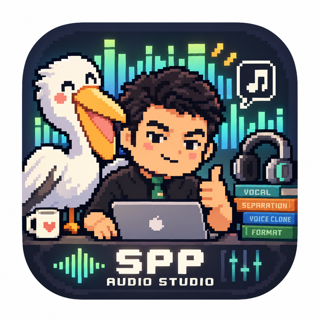

<div align="center">



# SPP Audio Studio

**面向创作者的本地 AI 音频工作台**

Windows · macOS ｜ 格式转换 · 人声分离 · 声音克隆

**当前版本：v1.0.2（双平台）**

[下载 v1.0.2](https://github.com/ndsmansyj/SPP-Audio-Studio/releases/tag/v1.0.2) · [更新日志](CHANGELOG.md) · [反馈问题](https://github.com/ndsmansyj/SPP-Audio-Studio/issues)

</div>

---

SPP Audio Studio 将音频格式转换、人声分离、声音克隆和试听集中到一款桌面软件中。输入文件默认只读，生成结果另存；AI 模型与推理主要在本机运行。

## 下载与安装

| 平台 | 版本与安装包 | 系统要求 |
| --- | --- | --- |
| **Windows x64** | [SPPAudioStudio-1.0.2-win-x64.zip](https://github.com/ndsmansyj/SPP-Audio-Studio/releases/download/v1.0.2/SPPAudioStudio-1.0.2-win-x64.zip) | Windows 10 / 11 x64；AI 功能建议使用 NVIDIA GPU |
| **macOS** | [SPP-Audio-Studio-1.0.2.dmg](https://github.com/ndsmansyj/SPP-Audio-Studio/releases/download/v1.0.2/SPP-Audio-Studio-1.0.2.dmg) | Apple Silicon；macOS 14 或更高 |

**[查看完整 Release 与 SHA-256 校验文件](https://github.com/ndsmansyj/SPP-Audio-Studio/releases/tag/v1.0.2)**

- **Windows：** 解压 ZIP 到独立文件夹，运行 `SPP Audio Studio.exe`。请勿只提取 EXE 或删除随附的 `app`、`worker`、`python-core` 文件夹。
- **macOS：** 打开 DMG，将 App 拖入“应用程序”文件夹；如果系统提示无法验证开发者，可在“系统设置 → 隐私与安全性”确认打开。
- **旧版本升级：** Windows 使用新版独立文件夹；macOS 可覆盖旧版应用。存放在用户数据目录的模型、模板和历史记录会保留。

普通用户无需自行安装系统 Python、Homebrew 或 Xcode。AI 功能首次运行时，进入软件的**「模型与环境」**安装所需的模型和运行环境。

## 功能

| 模块 | 功能 |
| --- | --- |
| **格式转换** | 导入支持的音频文件并另存转换结果 |
| **人声分离** | 使用 Mel-Deux 分离人声、伴奏或同时导出 |
| **声音克隆** | 使用 Qwen3-TTS 和参考音生成语音，管理常用人声模板 |
| **试听与历史** | 在应用内预览结果、管理任务和查看处理历史 |
| **模型管理** | 下载、校验或链接已有模型，检查本机运行环境 |

## v1.0.2 更新重点

**macOS：** 修复 Qwen 下载时错误断点文件导致的反复失败，增加 ModelScope / Hugging Face 自动换源，以及手动下载地址、模型存放目录入口。下载文件继续经过大小和 SHA-256 校验。

**Windows：** 修复切换来源时混用断点缓存的问题，增强失败恢复；增加模型下载地址与路径入口。Runtime 安装时的临时目录和 pip 缓存现在跟随 Runtime 目录，减少 C 盘空间不足造成的安装失败。

**模型与 Runtime 是两类不同数据。** Windows 的“模型存储位置”只控制模型文件，不会迁移 CUDA / PyTorch Runtime。若 C 盘空间不足，请检查 Runtime 和系统盘的实际剩余空间。macOS 使用 MLX 8-bit Qwen 权重，Windows 使用不同的 CUDA 版本模型，两者不能直接互换。

以上版本已通过自动化测试和构建检查；不同用户的网络状况、CUDA 环境及完整模型首次下载仍可能需要单独诊断。

## 故障排查

打开「模型与环境」→「刷新检查／重新检查」，使用**「复制诊断报告」**并将报告发至 [GitHub Issues](https://github.com/ndsmansyj/SPP-Audio-Studio/issues)。下载失败时，也可以展开模型卡片中的手动下载入口并按照目录结构保存文件。

## 开发与接口

- [Windows 开发、模型与 Runtime 说明](windows/README.md)
- [macOS 本机 API](LOCAL_API.md)
- [完整更新记录](CHANGELOG.md)

从源码构建：

```powershell
.\windows\build.ps1 -Configuration Release -Platform x64
```

```bash
./scripts/build_local.sh
```

## 许可证与第三方素材

本项目代码采用 [MIT License](LICENSE)。内置默认演示人声、图标与第三方模型遵守各自许可，详情见 [人声素材说明](VOICE_ASSET_LICENSE.md)、[品牌素材说明](BRANDING_ASSET_LICENSE.md) 和 [第三方声明](THIRD_PARTY_NOTICES.md)。

**Mel-Deux 模型采用 CC BY-NC 4.0，不适用于商业用途。**
